# 정민 (sidcatkr)

Founder of **[Lunive](https://lunive.app)**. CS student at Konkuk University, HCI Lab. 
Building Cadenza and Placery. Programming since 2018.

Lunive 대표. 건국대 컴퓨터공학, HCI 연구실.

---

## Lunive

> Software designed around the user.

Lunive is a user-experience-first software brand and company.

| Product | Description |
| :-- | :-- |
| [**Cadenza**](https://lunive.app/en/cadenza) | Discord music app. One `/play` command, plus a private web dashboard with queue, synced lyrics, and playback controls |
| [**Placery**](https://lunive.app/en/placery) | Inventory and moving app for Android, currently in closed testing on Google Play |

More at [lunive.app](https://lunive.app).

## Open Source

| Project | Description |
| :-- | :-- |
| [**CedeGrid**](https://github.com/sidcatkr/CedeGrid) | Resource manager written in Rust for elastic GPU/CPU pooling |

## Research

- Efficient computational architectures for LLMs beyond the Transformer
- Human-computer interaction at the HCI Lab
- Previously: AlphaZero-style reinforcement learning (Kaggriculture)

## Tech Stack

**Languages**

**Web and Runtime**

**Creative**

## GitHub Stats

<picture>
  <source media="(prefers-color-scheme: dark)" srcset="assets/stats-dark.svg">
  
</picture>

<picture>
  <source media="(prefers-color-scheme: dark)" srcset="assets/languages-dark.svg">
  
</picture>
